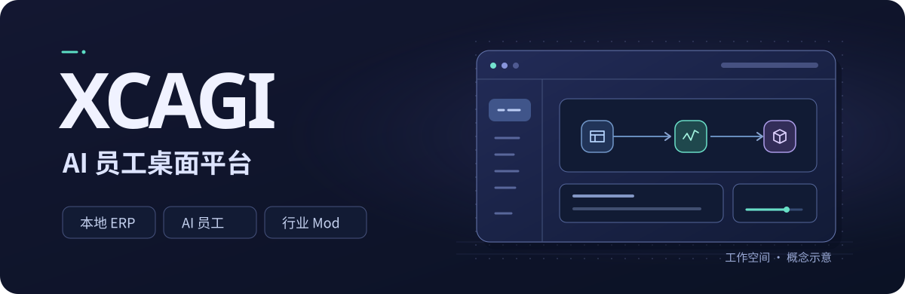

  

<h1 align="center">XCAGI · 企业 AI 员工桌面平台</h1>

  在桌面上处理企业业务：用本地 ERP 管数据，用 AI 员工办重复任务，按需安装行业 Mod。

  <a href="https://xiu-ci.com/download"><b>官方下载</b></a> ·
  <a href="https://xiu-ci.com/">产品官网</a> ·
  <a href="FHD/docs/XCAGI-客户使用说明书.md">使用说明</a> ·
  <a href="https://xiu-ci.com/contact.html">联系与演示</a>

## XCAGI 和 XCMAX 是什么？

**XCAGI** 是面向企业用户的桌面产品。**XCMAX** 是本仓库，包含 XCAGI 客户端、业务后端、行业模块及平台运营相关代码。仓库里的代码、实验功能和候选包不等于已经交付的产品。

## 一项业务怎么跑？

以整理考勤台账为例：先提供花名册、考勤表和业务规则，再在对话里说清要统计什么。

1. **交任务**：说明目标、时间范围和想要的输出。
2. **读数据、出计划**：AI 员工按当前账号权限读取现有资料，说明处理步骤；信息不够时先确认口径。
3. **授权再写入**：涉及新增、修改等写操作时，按权限和审批规则执行；未通过审批的操作不执行。
4. **核对结果**：查看处理记录和输出，复核异常明细，再使用或导出结果。

本地 ERP 提供业务记录和操作入口；AI 员工负责读取、规划与执行；行业 Mod 按场景补充工具、流程和模板。可用能力取决于部署方式、账号权限和已安装模块。

## 使用哪一端？

| 入口 | 用途 |
| --- | --- |
| **Windows / macOS 企业桌面端** | 企业业务主入口，用于处理 ERP 数据、对话派任务和使用已授权的行业 Mod。可用安装包与签名状态见[官方下载](https://xiu-ci.com/download)。 |
| **Flutter 移动端（Android / iOS）** | 桌面业务的配套客户端源码，面向移动查看与协作。Android 为实验渠道；iOS 是否可下载以 App Store 实际上架为准。源码或候选包不代表正式开放。 |
| **Web 平台管理端** | 用于平台运营与配置，不等同于企业桌面宿主，也不替代企业业务入口。 |

支持本地部署。平台模型、外部系统、模块下载或更新等能力可能需要联网，具体以所选部署方式和实际启用的集成为准。

## 从这里开始

- **安装和使用**：[官方下载](https://xiu-ci.com/download) · [客户使用说明书](FHD/docs/XCAGI-客户使用说明书.md)
- **查看源码**：[`FHD/`](FHD/) 为主要产品代码；移动端见 [`FHD/mobile-flutter-poc/`](FHD/mobile-flutter-poc/)。开发启动和仓库结构见[工程地图](docs/workmap.md)。
- **确认版本与授权**：[版本说明](FHD/VERSION.md) · [商业授权](FHD/COMMERCIAL_LICENSE.md) · [联系修茈科技](https://xiu-ci.com/contact.html)
